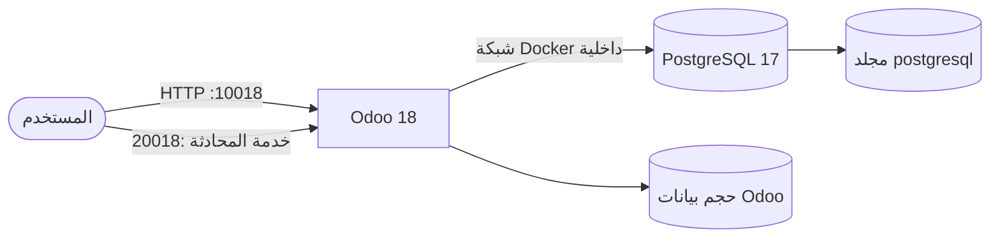
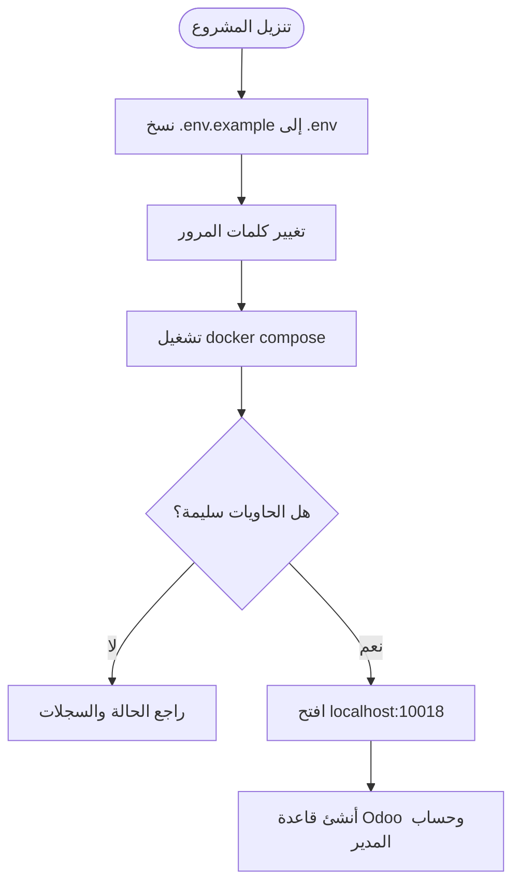
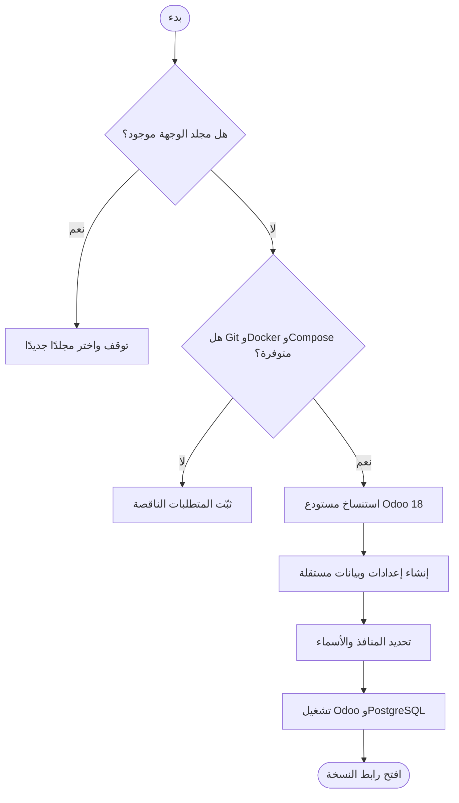
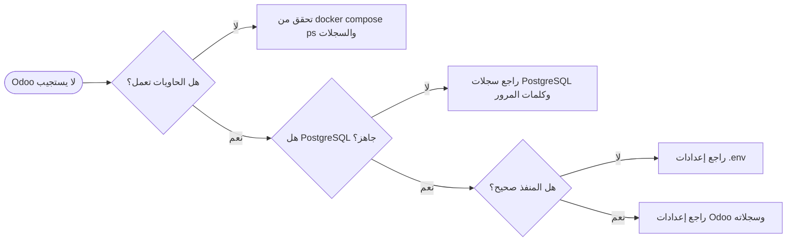

<div dir="rtl" align="right">

# دليل تثبيت Odoo 18 باستخدام Docker Compose

**Odoo 18 · PostgreSQL 17 · Docker Compose · دعم Traefik اختياري**

دليل عملي لتثبيت Odoo 18 وإدارته على Ubuntu/Linux، وتشغيل أكثر من نسخة
على الخادم نفسه عند الحاجة.

[التثبيت السريع](#-التثبيت-السريع) · [تثبيت نسخ متعددة](#-تثبيت-نسخ-متعددة) ·
[إدارة الحاويات](#-إدارة-الحاويات) · [استكشاف الأخطاء](#-استكشاف-الأخطاء)

</div>

---

## 📑 المحتويات

1. [نظرة عامة](#-نظرة-عامة)
2. [المتطلبات](#-المتطلبات)
3. [مخطط النظام](#-مخطط-النظام)
4. [معلومات الدخول والمنافذ](#-معلومات-الدخول-والمنافذ)
5. [التثبيت السريع](#-التثبيت-السريع)
6. [الإعدادات](#️-الإعدادات)
7. [تثبيت نسخ متعددة](#-تثبيت-نسخ-متعددة)
8. [Traefik وHTTPS](#-traefik-وhttps-اختياري)
9. [إدارة الحاويات](#-إدارة-الحاويات)
10. [النسخ الاحتياطي](#-النسخ-الاحتياطي)
11. [الصلاحيات وإعداد Linux](#️-الصلاحيات-وإعداد-linux)
12. [استكشاف الأخطاء](#-استكشاف-الأخطاء)
13. [هيكل المشروع والأمان](#-هيكل-المشروع-والأمان)
14. [روابط مفيدة](#-روابط-مفيدة)

---

## 🔎 نظرة عامة

يشغّل هذا المشروع Odoo 18 وقاعدة PostgreSQL 17 باستخدام Docker Compose.
يمكن تثبيت نسخة واحدة مباشرة، أو تثبيت عدة نسخ مستقلة عبر `run.sh`.

| الخدمة | الصورة | منافذ المضيف الافتراضية | التخزين الدائم |
|---|---|---|---|
| Odoo | `odoo:18` | `10018` للويب، `20018` للمحادثة | حجم Docker باسم `odoo18_data` |
| PostgreSQL | `postgres:17` | غير مكشوف للمضيف | المجلد `postgresql/` |

---

## ✅ المتطلبات

- Ubuntu/Linux. ويمكن استخدام Windows عبر WSL 2 مع تكامل Docker.
- Docker Engine.
- Docker Compose v2 (`docker compose`).
- اتصال بالإنترنت عند تنزيل الصور أول مرة.
- توفر المنفذين `10018` و`20018`، أو تحديد منافذ بديلة.

تحقق من التثبيت:

```bash
docker --version
docker compose version
docker run --rm hello-world
```

---

## 🏗️ مخطط النظام



قاعدة PostgreSQL متاحة داخل شبكة Docker الخاصة فقط. ينتظر Odoo جاهزية قاعدة
البيانات قبل بدء التشغيل.

---

## 🔐 معلومات الدخول والمنافذ

| البيان | القيمة الافتراضية | الاستخدام |
|---|---|---|
| كلمة مرور Odoo الرئيسية | `Admin@18` | عمليات إدارة قواعد البيانات في Odoo |
| مستخدم PostgreSQL | `odoo18` | اتصال Odoo بقاعدة البيانات |
| كلمة مرور PostgreSQL | `odoo@18` | اتصال Odoo بقاعدة البيانات |
| قاعدة PostgreSQL الابتدائية | `postgre` | تُنشأ عند تهيئة PostgreSQL لأول مرة |
| واجهة Odoo | [http://localhost:10018](http://localhost:10018) | واجهة النظام |
| منفذ المحادثة المباشرة | `20018` | خدمة المحادثة والاتصال المباشر |

> كلمة مرور Odoo الرئيسية ليست كلمة مرور حساب مدير النظام داخل قاعدة Odoo.
> استبدل القيم الافتراضية قبل إتاحة الخادم للإنترنت.

---

## 🚀 التثبيت السريع

### 1. تنزيل المشروع

```bash
git clone https://github.com/abdalazeim/InstallingOdoo18-Docker-Deployment.git
cd InstallingOdoo18-Docker-Deployment
```

أو نزّل المستودع بصيغة ZIP وفك ضغطه، ثم انتقل إلى مجلد المشروع.

### 2. إعداد البيئة والصلاحيات

```bash
cp .env.example .env
chmod 600 .env
mkdir -p postgresql
chmod 700 postgresql
chmod +x entrypoint.sh
```

عدّل كلمات المرور في `.env` قبل النشر العام.

### 3. تشغيل الخدمات

```bash
docker compose pull
docker compose up -d
docker compose ps
```

### 4. فتح النظام

- واجهة Odoo: [http://localhost:10018](http://localhost:10018)
- منفذ المحادثة المباشرة: `20018`

المنفذ `20018` لخدمة الاتصال المباشر، وليس واجهة ويب ثانية.



---

## ⚙️ الإعدادات

عدّل ملف `.env` لتخصيص الإعدادات. هذا الملف مستثنى من Git؛ لا ترفعه إلى
المستودع.

| المتغير | القيمة الافتراضية | الغرض |
|---|---|---|
| `ODOO_IMAGE` | `odoo:18` | صورة Odoo |
| `PG_IMAGE` | `postgres:17` | صورة PostgreSQL |
| `POSTGRES_USER` | `odoo18` | مستخدم PostgreSQL |
| `POSTGRES_PASSWORD` | `odoo@18` | كلمة مرور PostgreSQL |
| `POSTGRES_DB` | `postgre` | قاعدة PostgreSQL الابتدائية |
| `ODOO_ADMIN_PASSWORD` | `Admin@18` | كلمة مرور Odoo الرئيسية |
| `ODOO_HTTP_PORT` | `10018` | منفذ الويب على المضيف |
| `ODOO_CHAT_PORT` | `20018` | منفذ المحادثة على المضيف |
| `ODOO_NETWORK` | `odoo18_internal` | شبكة Docker الداخلية |
| `ODOO_CONTAINER_NAME` | `odoo18` | اسم حاوية Odoo |
| `ODOO_DB_CONTAINER_NAME` | `odoo18-db` | اسم حاوية PostgreSQL |
| `ODOO_DATA_VOLUME` | `odoo18_data` | حجم بيانات Odoo |
| `ODOO_DOMAIN` | مطلوب لـ Traefik | اسم النطاق |
| `DOCKER_PROXY_NETWORK` | `proxy` | شبكة Traefik الخارجية |
| `TRAEFIK_ENTRYPOINT` | `websecure` | مدخل Traefik |
| `CERTSRESOLVER` | `letsencrypt` | محلّل شهادات Traefik |

لتغيير منافذ المضيف، عدّل `.env` ثم أعد تطبيق Compose:

```dotenv
ODOO_HTTP_PORT=11018
ODOO_CHAT_PORT=21018
```

```bash
docker compose up -d
```

> **مهم:** متغيرات `POSTGRES_USER` و`POSTGRES_PASSWORD` و`POSTGRES_DB`
> تُستخدم عند إنشاء مجلد قاعدة البيانات أول مرة. تغييرها لاحقًا لا يغيّر
> بيانات قاعدة موجودة.

ضع الإضافات المخصصة في `addons/`، وعدّل إعدادات Odoo في `etc/odoo.conf`.
يحوّل ملف الدخول القيم السرية إلى ملف إعداد مؤقت داخل الحاوية.

---

## 🔁 تثبيت نسخ متعددة

يستنسخ `run.sh` المشروع إلى مجلد جديد، ويضبط المنافذ وأسماء الحاويات
والشبكات وأحجام البيانات لتكون مستقلة لكل نسخة. لا يستبدل مجلدًا موجودًا.



يتطلب السكربت Git وDocker Engine وDocker Compose v2 وصلاحية تشغيل Docker.
نفّذ الأوامر التالية من مجلد المستودع:

```bash
# النسخة الأولى
sudo bash run.sh --destination odoo-live --port 10018 --chat 20018

# النسخة الثانية بمنافذ مختلفة
sudo bash run.sh --destination odoo-test --port 11018 --chat 21018
```

| النسخة | مجلد التثبيت | رابط Odoo | منفذ المحادثة |
|---|---|---|---|
| `odoo-live` | `odoo-live/` | [http://localhost:10018](http://localhost:10018) | `20018` |
| `odoo-test` | `odoo-test/` | [http://localhost:11018](http://localhost:11018) | `21018` |

### تنزيل المشغّل مباشرة من GitHub

```bash
curl -fsSL https://raw.githubusercontent.com/abdalazeim/InstallingOdoo18-Docker-Deployment/main/run.sh \
  | sudo bash -s -- --destination odoo-live --port 10018 --chat 20018

curl -fsSL https://raw.githubusercontent.com/abdalazeim/InstallingOdoo18-Docker-Deployment/main/run.sh \
  | sudo bash -s -- --destination odoo-test --port 11018 --chat 21018
```

راجع السكربت قبل تشغيله مباشرة من الإنترنت. بعد التثبيت، أدر النسخة من
مجلدها:

```bash
cd odoo-live
docker compose ps
docker compose logs -f
```

لكل نسخة مجلد PostgreSQL وحجم Odoo منفصلان. غيّر كلمات المرور في ملف
`.env` الخاص بكل نسخة.

---

## 🌐 Traefik وHTTPS (اختياري)

يتطلب هذا الوضع وجود Traefik وشبكة Docker خارجية مشتركة معه.

1. اضبط النطاق والشبكة في `.env`:

   ```dotenv
   ODOO_DOMAIN=odoo.example.com
   DOCKER_PROXY_NETWORK=proxy
   TRAEFIK_ENTRYPOINT=websecure
   CERTSRESOLVER=letsencrypt
   ```

2. أنشئ شبكة Traefik إذا لم تكن موجودة:

   ```bash
   docker network create proxy
   ```

3. شغّل خدمات Traefik:

   ```bash
   docker compose -f docker-compose.traefik.yml up -d
   ```

4. اضبط DNS ومحلّل الشهادات في Traefik، ثم افتح
   `https://odoo.example.com`.

لا تشغّل ملف Compose العادي وملف Traefik للنسخة نفسها في وقت واحد.

---

## 🧰 إدارة الحاويات

نفّذ الأوامر من مجلد النسخة:

| العملية | الأمر |
|---|---|
| تشغيل الخدمات | `docker compose up -d` |
| عرض الحالة | `docker compose ps` |
| عرض السجلات | `docker compose logs -f` |
| سجلات Odoo | `docker compose logs -f odoo18` |
| سجلات PostgreSQL | `docker compose logs -f db` |
| إعادة التشغيل | `docker compose restart` |
| إيقاف مؤقت | `docker compose stop` |
| الإيقاف وحذف الحاويات مع الإبقاء على البيانات | `docker compose down` |

تستخدم الخدمات `restart: always` لإعادة التشغيل تلقائيًا عند تعطلها أو إعادة
تشغيل Docker.

> `docker compose down` يحتفظ بالبيانات. تجنّب `docker compose down -v` إلا
> إذا كنت تقصد حذف حجم Odoo، ولا تحذف مجلد `postgresql/` إذا أردت الاحتفاظ
> بقاعدة البيانات.

---

## 💾 النسخ الاحتياطي

احفظ نسخة من قاعدة البيانات وملفات Odoo:

```bash
mkdir -p backups
docker compose exec -T db pg_dumpall -U odoo18 > backups/postgresql-all.sql
docker compose exec -T odoo18 tar -C /var/lib/odoo -czf - . \
  > backups/odoo-data.tar.gz
```

نفّذ الأوامر من مجلد النسخة المطلوبة. النسخة الاحتياطية قد تحتوي بيانات
حساسة؛ احفظ نسخة إضافية خارج الخادم واختبر الاستعادة بانتظام.

---

## 🔒 الصلاحيات وإعداد Linux

### الصلاحيات

لا تستخدم `chmod -R 777`؛ فهي تمنح جميع مستخدمي الخادم صلاحيات القراءة
والكتابة والتنفيذ. استخدم صلاحيات محدودة:

```bash
chmod 600 .env
chmod 700 postgresql
chmod +x entrypoint.sh
```

عند ظهور مشكلة صلاحيات، افحص المسار والسجلات أولًا:

```bash
docker compose logs --tail=100
ls -ld addons etc postgresql
```

لا تجعل ملفات الأسرار أو بيانات قاعدة البيانات قابلة للكتابة من جميع
مستخدمي النظام.

### زيادة حد مراقبة الملفات (اختياري)

قد يفيد هذا الضبط عند تشغيل نسخ متعددة إذا ظهرت رسالة تفيد بتجاوز حد مراقبة
الملفات. لا يلزم عادةً لتشغيل نسخة واحدة:

```bash
if grep -qF "fs.inotify.max_user_watches" /etc/sysctl.conf; then
  grep -F "fs.inotify.max_user_watches" /etc/sysctl.conf
else
  echo "fs.inotify.max_user_watches = 524288" | sudo tee -a /etc/sysctl.conf
fi

sudo sysctl -p
```

---

## 🩺 استكشاف الأخطاء

| المشكلة | التحقق أو الحل |
|---|---|
| منفذ مستخدم من خدمة أخرى | غيّر `ODOO_HTTP_PORT` أو `ODOO_CHAT_PORT` في `.env` ثم أعد تشغيل Compose |
| Odoo لا يتصل بـ PostgreSQL | `docker compose logs db odoo18` |
| التحقق من جاهزية PostgreSQL | `docker compose exec db pg_isready -U odoo18 -d postgre` |
| Odoo لا يبدأ | `docker compose logs --tail=100 odoo18` |
| بيانات الدخول القديمة ما زالت مستخدمة | متغيرات PostgreSQL لا تعيد تهيئة مجلد بيانات موجود |
| Traefik لا يصل إلى Odoo | تحقق من DNS والشبكة واسم النطاق ومدخل وشهادة Traefik |



---

## 🗂️ هيكل المشروع والأمان

```text
InstallingOdoo18-Docker-Deployment/
├── addons/                       # إضافات Odoo المخصصة
├── etc/
│   └── odoo.conf                 # قالب إعداد Odoo
├── screenshots/                  # صور توضيحية لـ Odoo 18
├── postgresql/                   # بيانات PostgreSQL الدائمة
├── .env.example                  # نموذج متغيرات البيئة
├── docker-compose.yml            # تشغيل مباشر بالمنافذ
├── docker-compose.traefik.yml    # تشغيل اختياري عبر Traefik
├── entrypoint.sh                 # إعداد وقت التشغيل وانتظار PostgreSQL
├── run.sh                        # تثبيت نسخ متعددة
├── README.md                     # الدليل الإنجليزي
└── InstallingOdoo 18.0Command.md # الدليل العربي
```

### قائمة أمان

- استبدل كلمات المرور التجريبية قبل إتاحة النظام للعامة.
- لا ترفع `.env` أو النسخ الاحتياطية أو بيانات قاعدة البيانات إلى GitHub.
- لا تنشر منفذ PostgreSQL إلى الإنترنت.
- استخدم HTTPS عبر وكيل عكسي موثوق في بيئة الإنتاج.
- حدّث Docker وصور الحاويات باستمرار.

---

## 🔗 روابط مفيدة

- [مستودع Odoo 18 على GitHub](https://github.com/abdalazeim/InstallingOdoo18-Docker-Deployment)
- [توثيق Odoo 18](https://www.odoo.com/documentation/18.0/)
- [توثيق Docker Compose](https://docs.docker.com/compose/)
- [الإبلاغ عن مشكلة](https://github.com/abdalazeim/InstallingOdoo18-Docker-Deployment/issues)
