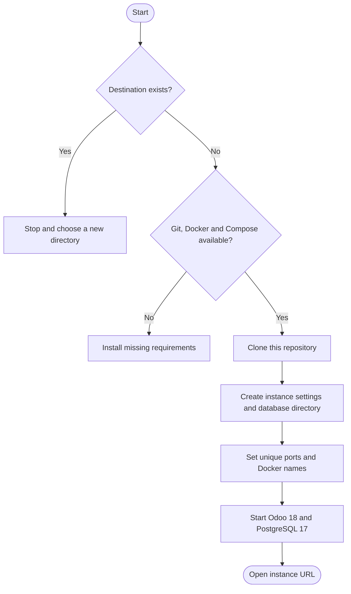
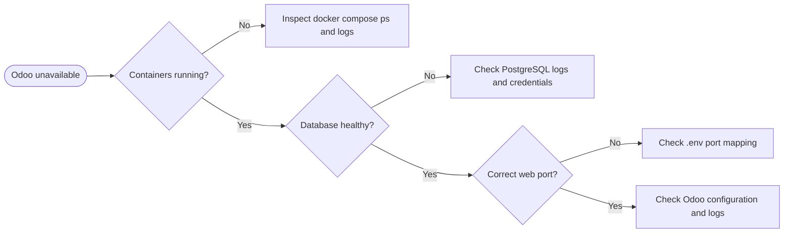

<div align="center">

# Odoo 18 · Docker Deployment

**Odoo 18 + PostgreSQL 17 · Docker Compose · Optional Traefik**

[](https://www.odoo.com/)
[](https://www.postgresql.org/)
[](https://docs.docker.com/compose/)

[Quick Start](#4-quick-start) · [Multiple Instances](#7-multiple-instances) · [Operations](#9-container-management) · [Troubleshooting](#12-troubleshooting)

</div>

---

## Contents

1. [Overview](#1-overview)
2. [Requirements](#2-requirements)
3. [Architecture](#3-architecture)
4. [Quick Start](#4-quick-start)
5. [Access and Initial Credentials](#5-access-and-initial-credentials)
6. [Configuration](#6-configuration)
7. [Multiple Instances](#7-multiple-instances)
8. [Traefik / HTTPS](#8-traefik--https)
9. [Container Management](#9-container-management)
10. [Backups](#10-backups)
11. [Linux Host Tuning and Permissions](#11-linux-host-tuning-and-permissions)
12. [Troubleshooting](#12-troubleshooting)
13. [Project Layout and Security](#13-project-layout-and-security)
14. [References](#14-references)

---

## 1. Overview

Deploy Odoo 18 with PostgreSQL 17 using Docker Compose. Use the standard
configuration for one instance, `run.sh` for separate instances, or the
optional Traefik Compose file for HTTPS behind an existing reverse proxy.

| Service | Image | Host ports | Persistent data |
|---|---|---|---|
| Odoo | `odoo:18` | `10018` web · `20018` live communication | `odoo18_data` volume |
| PostgreSQL | `postgres:17` | Not published | `./postgresql/` |

## 2. Requirements

- Docker Engine.
- Docker Compose v2 (`docker compose`).
- Ubuntu/Linux server. On Windows, use WSL 2 with Docker integration.
- Available host ports `10018` and `20018`, unless changed in `.env`.

## 3. Architecture

```mermaid
flowchart LR
    U([User]) -->|HTTP :10018| O[Odoo 18]
    U -->|Live service :20018| O
    O -->|Private Docker network| D[(PostgreSQL 17)]
    D --> P[(./postgresql)]
    O --> F[(odoo18_data volume)]
```



PostgreSQL is not exposed on a host port. Compose waits for the database
health check before starting Odoo; the Odoo entrypoint also waits for the
database connection.

## 4. Quick Start

### Get the project

```bash
git clone https://github.com/abdalazeim/InstallingOdoo18-Docker-Deployment.git
cd InstallingOdoo18-Docker-Deployment
```

### Create local settings and data directory

```bash
cp .env.example .env
chmod 600 .env
mkdir -p postgresql
chmod 700 postgresql
chmod +x entrypoint.sh
```

Change the example passwords in `.env` before exposing the service publicly.

### Start Odoo and PostgreSQL

```bash
docker compose pull
docker compose up -d
docker compose ps
```

## 5. Access and Initial Credentials

| Service | Address |
|---|---|
| Odoo web interface | **[http://localhost:10018](http://localhost:10018)** |
| Live communication / WebSocket port | `20018` |

Port `20018` is used by Odoo's live communication service; it is not a second
web interface.

| Credential | Initial value | Purpose |
|---|---|---|
| Odoo master password | `Admin@18` | Database-management operations in Odoo |
| PostgreSQL user | `odoo18` | Odoo-to-PostgreSQL connection |
| PostgreSQL password | `odoo@18` | Odoo-to-PostgreSQL connection |
| Initial PostgreSQL database | `postgre` | Database initialized by the PostgreSQL image |

These are example values for initial setup, not production credentials.
The Odoo master password is different from the administrator login created
inside an Odoo application database.

## 6. Configuration

Edit `.env`. It is excluded from Git; never commit secrets.

| Variable | Default | Description |
|---|---|---|
| `ODOO_IMAGE` | `odoo:18` | Odoo image |
| `PG_IMAGE` | `postgres:17` | PostgreSQL image |
| `POSTGRES_USER` | `odoo18` | PostgreSQL role |
| `POSTGRES_PASSWORD` | `odoo@18` | PostgreSQL role password |
| `POSTGRES_DB` | `postgre` | Initial PostgreSQL database |
| `ODOO_ADMIN_PASSWORD` | `Admin@18` | Odoo master password |
| `ODOO_HTTP_PORT` | `10018` | Host port mapped to Odoo `8069` |
| `ODOO_CHAT_PORT` | `20018` | Host port mapped to Odoo `8072` |
| `ODOO_NETWORK` | `odoo18_internal` | Private Docker network |
| `ODOO_CONTAINER_NAME` | `odoo18` | Odoo container name |
| `ODOO_DB_CONTAINER_NAME` | `odoo18-db` | PostgreSQL container name |
| `ODOO_DATA_VOLUME` | `odoo18_data` | Persistent Odoo data volume |
| `ODOO_DOMAIN` | Required for Traefik | Public hostname |
| `DOCKER_PROXY_NETWORK` | `proxy` | Existing Traefik Docker network |
| `TRAEFIK_ENTRYPOINT` | `websecure` | Traefik entrypoint |
| `CERTSRESOLVER` | `letsencrypt` | Traefik certificate resolver |

For alternate host ports, update `.env` and recreate the services:

```dotenv
ODOO_HTTP_PORT=11018
ODOO_CHAT_PORT=21018
```

```bash
docker compose up -d
```

PostgreSQL initialization settings are applied only when its data directory
is first created. Changing `POSTGRES_USER`, `POSTGRES_PASSWORD`, or
`POSTGRES_DB` later does not modify existing database roles, passwords, or
databases.

Place custom addons in [`addons/`](addons/). Edit Odoo settings in
[`etc/odoo.conf`](etc/odoo.conf). Runtime secrets are rendered into a
temporary, private configuration file and should not be written into tracked
files.

## 7. Multiple Instances

The `run.sh` helper clones this repository into a **new destination
directory**, creates a private `.env`, sets unique ports, container names,
network and data volume, then starts Docker Compose. It will not overwrite an
existing destination.



Requirements: Git, Docker Engine, Docker Compose v2, and permission to use
Docker. Run from the repository root:

```bash
# Production or live instance
sudo bash run.sh --destination odoo-live --port 10018 --chat 20018

# Test instance on separate ports
sudo bash run.sh --destination odoo-test --port 11018 --chat 21018
```

| Instance | Directory | Odoo URL | Live communication |
|---|---|---|---|
| `odoo-live` | `odoo-live/` | [http://localhost:10018](http://localhost:10018) | `20018` |
| `odoo-test` | `odoo-test/` | [http://localhost:11018](http://localhost:11018) | `21018` |

The installer can also be downloaded from this repository's `main` branch.
Review remote scripts before executing them:

```bash
curl -fsSL https://raw.githubusercontent.com/abdalazeim/InstallingOdoo18-Docker-Deployment/main/run.sh \
  | sudo bash -s -- --destination odoo-live --port 10018 --chat 20018

curl -fsSL https://raw.githubusercontent.com/abdalazeim/InstallingOdoo18-Docker-Deployment/main/run.sh \
  | sudo bash -s -- --destination odoo-test --port 11018 --chat 21018
```

Manage an installed instance from its directory:

```bash
cd odoo-live
docker compose ps
docker compose logs -f
```

Each instance has its own PostgreSQL directory and Odoo named volume. Change
the default credentials in each instance's `.env`.

## 8. Traefik / HTTPS

Use [`docker-compose.traefik.yml`](docker-compose.traefik.yml) only if Traefik
is already running and connected to an existing external Docker network.

Set the domain and network in `.env`:

```dotenv
ODOO_DOMAIN=odoo.example.com
DOCKER_PROXY_NETWORK=proxy
TRAEFIK_ENTRYPOINT=websecure
CERTSRESOLVER=letsencrypt
```

If needed, create the shared network, then start the Traefik configuration:

```bash
docker network create proxy
docker compose -f docker-compose.traefik.yml up -d
```

Configure DNS and Traefik's certificate resolver, then open
`https://odoo.example.com`. Do not run both Compose modes for the same
instance at the same time.

## 9. Container Management

Run commands from the instance directory:

| Action | Command |
|---|---|
| Start | `docker compose up -d` |
| Status | `docker compose ps` |
| Follow all logs | `docker compose logs -f` |
| Odoo logs | `docker compose logs -f odoo18` |
| PostgreSQL logs | `docker compose logs -f db` |
| Restart | `docker compose restart` |
| Stop but keep containers | `docker compose stop` |
| Stop and remove containers, keep data | `docker compose down` |

The services use `restart: always`. `docker compose down` preserves the
PostgreSQL directory and named Odoo volume. Avoid `docker compose down -v`
unless you intend to remove the named volume. Do not delete `postgresql/`
unless you intend to remove the database.

## 10. Backups

Back up the PostgreSQL database and Odoo data volume:

```bash
mkdir -p backups
docker compose exec -T db pg_dumpall -U odoo18 > backups/postgresql-all.sql
docker compose exec -T odoo18 tar -C /var/lib/odoo -czf - . \
  > backups/odoo-data.tar.gz
```

Run these commands from the instance directory. For a `run.sh` instance, the
Compose project uses the same service names (`db` and `odoo18`) inside the
project, so these commands also apply there.

Protect backups because they may contain sensitive business data. Keep an
additional copy outside the server and test restoration regularly.

## 11. Linux Host Tuning and Permissions

### File permissions

Do **not** use `chmod -R 777`; it gives every local user read/write/execute
access. Use restrictive permissions:

```bash
chmod 600 .env
chmod 700 postgresql
chmod +x entrypoint.sh
```

For a permission error, inspect the affected directory and logs before
changing ownership:

```bash
docker compose logs --tail=100
ls -ld addons etc postgresql
```

Do not make database files or secrets world-writable.

### Optional · Increase Linux inotify watches

This host-level setting may help when running multiple instances if the
system reports that its file-watch limit is exhausted. It is not normally
required for one instance.

```bash
if grep -qF "fs.inotify.max_user_watches" /etc/sysctl.conf; then
  grep -F "fs.inotify.max_user_watches" /etc/sysctl.conf
else
  echo "fs.inotify.max_user_watches = 524288" | sudo tee -a /etc/sysctl.conf
fi

sudo sysctl -p
```

## 12. Troubleshooting

| Symptom | Check |
|---|---|
| A host port is occupied | Change `ODOO_HTTP_PORT` / `ODOO_CHAT_PORT`, then run `docker compose up -d` |
| Odoo cannot connect to PostgreSQL | `docker compose logs db odoo18` |
| Check PostgreSQL readiness | `docker compose exec db pg_isready -U odoo18 -d postgre` |
| Odoo fails to start | `docker compose logs --tail=100 odoo18` |
| Changed credentials do not work on an existing database | PostgreSQL does not reinitialize existing data from `.env` |
| Traefik cannot route to Odoo | Check DNS, external network, domain, entrypoint and certificate resolver |



## 13. Project Layout and Security

```text
InstallingOdoo18-Docker-Deployment/
├── addons/                       # Custom Odoo addons
├── etc/
│   └── odoo.conf                 # Odoo configuration template
├── screenshots/                  # Example Odoo 18 screens
├── postgresql/                   # Persistent PostgreSQL data
├── .env.example                  # Environment template
├── docker-compose.yml            # Direct host-port deployment
├── docker-compose.traefik.yml    # Optional Traefik deployment
├── entrypoint.sh                 # Runtime config and database wait
├── run.sh                        # Optional multi-instance installer
├── README.md                     # English guide
└── InstallingOdoo 18.0Command.md # Arabic guide
```

### Security checklist

- [ ] Replace the example Odoo and PostgreSQL passwords.
- [ ] Keep `.env`, backups and database data out of Git.
- [ ] Do not expose PostgreSQL's port to the internet.
- [ ] Use HTTPS through a trusted reverse proxy for public access.
- [ ] Keep Docker Engine and container images updated.

## 14. References

- [Odoo 18 documentation](https://www.odoo.com/documentation/18.0/)
- [Docker Compose documentation](https://docs.docker.com/compose/)
- [GitHub repository](https://github.com/abdalazeim/InstallingOdoo18-Docker-Deployment)
- [Report an issue](https://github.com/abdalazeim/InstallingOdoo18-Docker-Deployment/issues)
